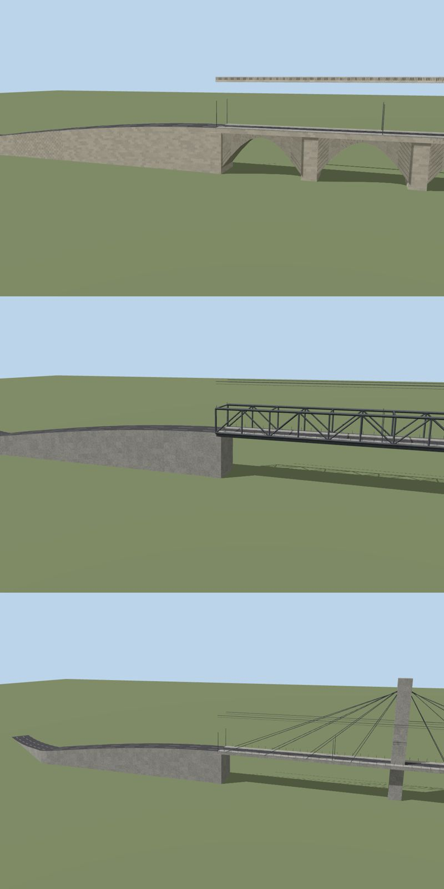

# X-Plane AI-Scenery Builder

> 🇩🇪 Deutsche Version: [README.de.md](README.de.md) · 📖 Full user manual: [docs/MANUAL.md](docs/MANUAL.md)

**Draw an area on the map – get an X-Plane 12 scenery package that looks like the real place.**

A free Windows desktop app for the flight-sim community. It builds stadiums, palaces,
churches, bridges, halls, rows of houses, grandstands, fences, whole towns and the ground
surfaces around them, and installs the result straight into `Custom Scenery`.


The app finds out **what** stands in the area (OpenStreetMap, aerial imagery, Wikidata and
Wikipedia, free street-level photos), works out **how it looks**, builds a 3D model of
every object, packs everything into an overlay scenery and installs it.

**Guiding principle: you stay in charge.** Before every step that has an effect –
downloading data, spending money on AI, writing files, touching your X-Plane folder – the
app stops and tells you *what will happen, what it costs and where it writes*. Nothing
happens without your OK.

> **Status: preview (milestone 3).** The whole flow works end to end and produces real
> packages, but this is young software. Reports from X-Plane are very welcome – see
> [Help us test](#help-us-test).

---

## Contents

- [What it can do](#what-it-can-do)
- [Requirements](#requirements)
- [Installation](#installation)
- [Quick start (5 steps)](#quick-start-5-steps)
- [AI: Claude or Gemini, and what it costs](#ai-claude-or-gemini-and-what-it-costs)
- [Data sources, licences and privacy](#data-sources-licences-and-privacy)
- [Help us test](#help-us-test)
- [For developers](#for-developers)
- [Licence](#licence)

---

## What it can do

| | |
|---|---|
| 🏟️ **Landmarks with real detail** | Facades with windows set into the wall, cornices, pilasters, arches, mansard and hipped roofs, towers, balustrades, chimneys, courtyards; normal maps for joints and tiles. Stadiums with tiers, seat colours, roofs and floodlights. |
| 🧠 **AI architect** *(optional)* | Rebuilds important objects one by one from map data, aerial image, research and photos. You can ask for changes in your own words: *"the roof should cover the whole stand"*, *"add a clock tower"*. |
| 🌉 **Bridges** | Beam, arch, truss, suspension and cable-stayed bridges with piers, ramps joined to the roads, deck heights taken from X-Plane's own terrain. The real bridge is painted out of the aerial image underneath. |
| 🏘️ **City mode** | All ordinary houses of an area in a few blocks (very FPS-friendly), real roof shapes from official 3D data in Bavaria, rows of houses under one roof, soft contact shadows. Landmarks stay single, detailed objects. |
| 🖼️ **Facades from photos** | Mark the four corners of a facade on a photo – the app straightens it and puts it on the model, the way hand-made sceneries do. Only photos whose licence allows it. |
| 🗿 **Statues and monuments** | A figure kit (standing, riding, seated, bust…) on a pedestal – or the real free 3D scan from Wikimedia Commons if one exists. |
| 🌙 **Night** | Lit windows, floodlit landmarks, stadium floodlights and street lamps with X-Plane 12's own lights. |
| 🚀 **Performance** | Three levels of detail per object (close, far, very far), city blocks instead of thousands of single objects, X-Plane library objects for lamps, trees and cars. |
| 🎨 **Blender** *(optional)* | Bakes soft shading and weathering into the textures at build time. |
| 🧩 **Plays nicely with other sceneries** | Hides the objects of other packs exactly where your new ones stand, keeps your ortho ground if you want. |
| ✋ **Hands-on 3D preview** | See every object before it is built, day and night. Move, turn, delete, change height or roof – also after the build. |
| 🛡️ **Safe** | AI-written build scripts run in a sandbox that can only describe geometry. Your keys never leave the Windows Credential Manager. |



## Requirements

| | |
|---|---|
| **Required** | Windows 10/11 (64-bit), X-Plane 12 |
| **Optional: AI** | Your own API key for **Claude** ([Anthropic](https://console.anthropic.com)) **or Gemini** ([Google AI Studio](https://aistudio.google.com)) – or both. You pay the provider directly; the app never goes over the limits you set. Without a key the app still works, with its built-in build scripts. |
| **Optional: street photos** | A free [Mapillary](https://www.mapillary.com/developer) token |
| **Optional: worldwide aerial imagery** | Your own [ArcGIS](https://developers.arcgis.com) key for Esri World Imagery – used **only for recognition**, never put into a package |
| **Optional: nicer shading** | [Blender](https://www.blender.org) 3.x or newer (4.x/5.x recommended) |
| **Optional: terrain-aware heights** | Laminar's **DSFTool** – the installer brings it along |

## Installation

There is no official release yet. Every push builds a Windows installer automatically:

1. Open the [latest successful CI run](https://github.com/Jumanja991xx/xplane-osm-imagery-model-transformer/actions/workflows/ci.yml?query=is%3Asuccess)
   (you need to be logged in to GitHub to download artifacts).
2. Download the artifact **XPSB-Setup-windows-x64**, unzip it and run the setup.
   It installs for your user only – no administrator rights needed.
3. Start the app → **☰ Menu → Settings → General** and choose your X-Plane 12 folder
   (**Detect automatically** usually finds it).
4. Optional: **Settings → AI** – paste your Claude and/or Gemini key.

The app stores its jobs in `%APPDATA%\XPlaneAISceneryBuilder`.

## Quick start (5 steps)

The left side of the window leads you through five steps; the map is on the right. Every
step ends with the same bar: **← back** on the left, the next action on the right. You can
also click any earlier step at the top – nothing you did is lost.

| Step | What you do |
|---|---|
| **1 · Area** | Search a place (*"Allianz Arena"*) or move the map, then click **Draw rectangle** or **Draw polygon** and draw the area (up to 25 km²). |
| **2 · Wishes** | Give the scenery a name and say what to build. *"Everything"* is a good start. Choose single objects or **whole town**, how the ground should look, and whether the AI may help. |
| **3 · Objects** | The app loads map data and the aerial image and lists what it found. Check the list: fix heights and roofs, accept or reject AI suggestions, draw missing objects, remove what you don't want. |
| **4 · Preview & build** | Every object is built and shown in a **3D preview** (day and night). Adjust what you like, then **Build**. |
| **5 · Install** | The package is checked and copied into `Custom Scenery`. Start X-Plane and fly there. |

At each of the four "costly" moments – start analysis, create build plan, build, install –
a short dialog asks first and shows what happens and what it costs.

➡️ **All details, tips and troubleshooting: [the user manual](docs/MANUAL.md).**

<p>


</p>

## AI: Claude or Gemini, and what it costs

The AI is optional. It looks at the aerial image for things missing on the map, answers
open questions (height, roof, colours), and the **AI architect** designs important objects
individually.

| Provider | Models offered |
|---|---|
| **Claude** (Anthropic) | Opus 5.5 (best), Sonnet 5.5, Haiku 5.5 (cheapest) |
| **Gemini** (Google) | 3.1 Pro (preview), 3.8 Flash, 3.6 Flash, 3 Flash (preview), 3.5 Flash-Lite, 3.1 Flash-Lite, 2.5 Pro, 2.5 Flash |

- **Your key, your bill.** You pay the provider directly. Keys live only in the Windows
  Credential Manager.
- **Hard limits.** A limit per job and per month. Every AI step shows its maximum cost
  before it starts; the app stops when a limit is reached.
- **Save costs** (on by default): a cheaper model of the same provider looks at the aerial
  image (Opus → Sonnet, Gemini Pro → Flash); only the AI architect uses your chosen model.
- **Exact bill.** After the build the app lists every AI call with its tokens and cost.
- **Gemini changes fast.** *Settings → AI → Load available Gemini models* asks Google which
  models your key can use right now (Google offers the 2.5 models only to accounts that
  used them before).

A typical landmark job costs a few cents up to about one US dollar.

## Data sources, licences and privacy

- **Map data** © OpenStreetMap contributors, [ODbL](https://www.openstreetmap.org/copyright),
  credited in every package. If the public Overpass servers are busy, the app asks the next
  one, then uses older data from its cache or OpenStreetMap's own API.
- **Built-in aerial imagery** – open government imagery, chosen automatically by where the
  area is: Germany (all 16 states), Switzerland, Austria, the Netherlands, France, Spain,
  the USA, and Japan (recognition only). You can add your own WMS/XYZ source if you have the
  right to use it. Google, Bing and Apple imagery are **not** built in.
- **Esri World Imagery** (your own key) is used for recognition only and never goes into
  a package.
- **Official 3D buildings** of Bavaria (LoD2) for city mode – © Bayerische
  Vermessungsverwaltung, CC BY 4.0, credited in the package.
- **Photos** come from your own uploads, Wikimedia Commons, Panoramax and Mapillary. A photo
  only becomes part of a package if its licence allows sharing; photographers are named in
  the package README. Free 3D scans only under CC0/PD/CC BY/CC BY-SA.
- **Your data stays on your PC.** Data leaves it only for the sources above and, if you
  turn the AI on, for the AI provider you chose (aerial crops, map tags, photos, your notes).

## Help us test

Some things can only be judged in the simulator – screenshots and reports help a lot:

- Do window frames and joints look **raised** (right) or **pressed in**?
- Do the soft contact shadows lie cleanly on the ground in city mode?
- Are lit windows, floodlights and street lamps too bright or too dark at night?
- Do bridges meet the river banks and roads?
- Do flags fly **downwind**?

Please open an [issue](https://github.com/Jumanja991xx/xplane-osm-imagery-model-transformer/issues)
with a screenshot, the place and – if something failed – the text of the error message.

## For developers

```
apps/frontend/          React + TypeScript + Tailwind + MapLibre + Terra Draw + three.js
apps/desktop/src-tauri/ Tauri shell (Rust): starts the backend invisibly, NSIS installer
backend/                Python backend (FastAPI): approvals, AI, build kit, X-Plane writers
tools/                  build DSFTool from Laminar's source, packaging, smoke test
tests/e2e/              browser test of the complete wizard (offline fixtures, simulated AI)
docs/                   user manual, architecture, verified X-Plane format notes
```

Requirements: Python ≥ 3.12 with [uv](https://docs.astral.sh/uv/), Node 22 with pnpm,
Rust (stable), CMake and a C++ compiler (Windows: Visual Studio Build Tools).

```bash
python tools/build_dsftool.py --fetch-zlib   # DSFTool from Laminar's original source (MIT)
pnpm install
cd backend && uv sync && cd ..

pnpm dev:backend      # terminal 1: backend on 127.0.0.1:8765, token "dev"
pnpm dev:frontend     # terminal 2: UI in the browser on http://localhost:1420
# or as the desktop app (starts the backend itself):
pnpm tauri dev
```

Tests:

```bash
cd backend && uv run pytest -q && uv run ruff check . ../tools
pnpm typecheck
cargo test --manifest-path apps/desktop/src-tauri/Cargo.toml
```

Offline development: `XPSB_FIXTURES_DIR=backend/tests/fixtures/speedway` serves OSM data
and imagery from test files, `XPSB_FAKE_AI` simulates the AI (no key, no cost) – see
[`tests/e2e/README.md`](tests/e2e/README.md). The CI
([`.github/workflows/ci.yml`](.github/workflows/ci.yml)) runs the tests on Linux and
Windows, builds DSFTool from source, packages the backend and creates the installer.

More: [`docs/ARCHITECTURE.md`](docs/ARCHITECTURE.md) ·
[`docs/xplane-format-notes.md`](docs/xplane-format-notes.md)

## Licence

MIT – see [`LICENSE`](LICENSE). Third-party components: [`third_party/`](third_party/).
Map data © OpenStreetMap contributors (ODbL).

X-Plane is a trademark of Laminar Research. This project is not affiliated with Laminar
Research, Anthropic, Google, Esri, Mapillary or the Blender Foundation.
