# User manual – X-Plane AI-Scenery Builder

This manual walks you through the app from the first start to a finished scenery in
X-Plane 12, and explains every option on the way. Short version: [README](../README.md#quick-start-5-steps).

**Contents**

1. [Before you start](#1-before-you-start)
2. [The window at a glance](#2-the-window-at-a-glance)
3. [Step 1 – Area](#3-step-1--area)
4. [Step 2 – Wishes](#4-step-2--wishes)
5. [Step 3 – Objects](#5-step-3--objects)
6. [Step 4 – Preview & build](#6-step-4--preview--build)
7. [Step 5 – Install](#7-step-5--install)
8. [Changing things after the build](#8-changing-things-after-the-build)
9. [City mode](#9-city-mode)
10. [Bridges](#10-bridges)
11. [Photos and facades](#11-photos-and-facades)
12. [Working with the AI](#12-working-with-the-ai)
13. [Settings](#13-settings)
14. [Your scenery in X-Plane](#14-your-scenery-in-x-plane)
15. [Troubleshooting and FAQ](#15-troubleshooting-and-faq)
16. [Glossary](#16-glossary)

---

## 1. Before you start

**You need**

- Windows 10/11 (64-bit) and X-Plane 12.
- The app installed (see [Installation](../README.md#installation)).

**Good to have**

| What | Why | Where to get it |
|---|---|---|
| Claude or Gemini API key | AI help: finds what the map misses, designs landmarks individually, takes corrections in your own words | [console.anthropic.com](https://console.anthropic.com) · [aistudio.google.com](https://aistudio.google.com) |
| Blender 3.x or newer | Soft shading and weathering baked into the textures | [blender.org](https://www.blender.org) |
| Mapillary token | More street-level photos of your objects | [mapillary.com/developer](https://www.mapillary.com/developer) |
| ArcGIS key | Aerial imagery where no open imagery exists (recognition only) | [developers.arcgis.com](https://developers.arcgis.com) |

**First start**

1. Open **☰ Menu → Settings → General**.
2. Click **Detect automatically** and pick your X-Plane 12 folder, or type the path and
   click **Check**. A green ✓ means it is right.
3. If you have an AI key: **Settings → AI**, paste it, click **Save**.
4. Click **Save** at the bottom and close the settings.

As long as no X-Plane folder is set, a yellow note at the top of the window reminds you.

---

## 2. The window at a glance

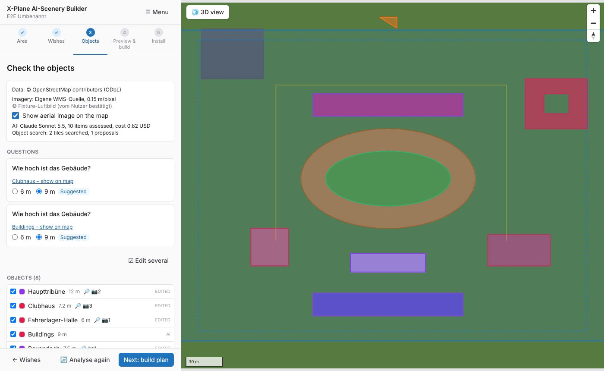

- **Left:** the job. At the top the app name and the name of the open job, the **☰ Menu**,
  then the five steps. Below that the content of the current step, and at the very
  bottom a bar with **← back** (left) and the next action (right).
- **Right:** the map. Your area, the found objects (coloured by kind), the aerial image and
  a **3D view** button.

**The menu (☰)**

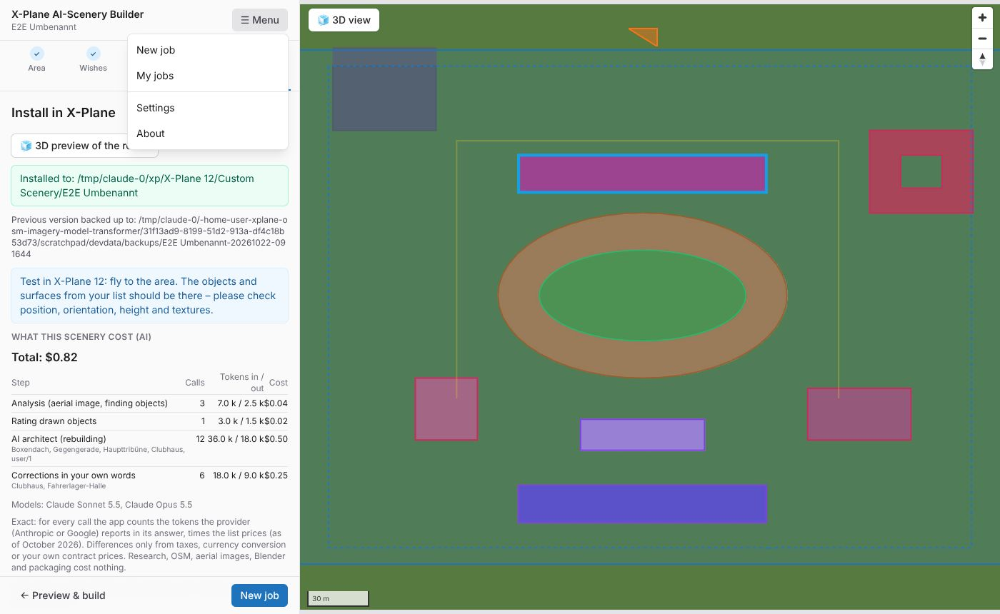

| Entry | What it does |
|---|---|
| New job | Closes the current job (it is kept) and starts a new one. |
| My jobs | All your jobs, newest first, with a search field. Click **Open** to continue one. |
| Cancel this job | Stops the job after a confirmation. You can come back to it later via *My jobs*. |
| Settings | X-Plane folder, AI keys and models, imagery, tools – see [Settings](#13-settings). |
| About | Version and data credits. |

**Moving between steps**

- **← back** in the bar at the bottom always goes one step back.
- The step headers at the top can be clicked for every step you already passed.
- Going back never throws work away: your edited list, the 3D preview and the designs of
  the AI architect stay. Only what really depends on your change is redone.

**Approvals**

Before anything with an effect happens, a short dialog asks – *Start the analysis?*,
*Create the build plan?*, *Build the scenery?*, *Install in X-Plane?*. It shows warnings
first, then what happens, then the **costs** (highlighted). Technical details (folders,
duration) are folded under **Details**. Nothing happens until you click the blue button.

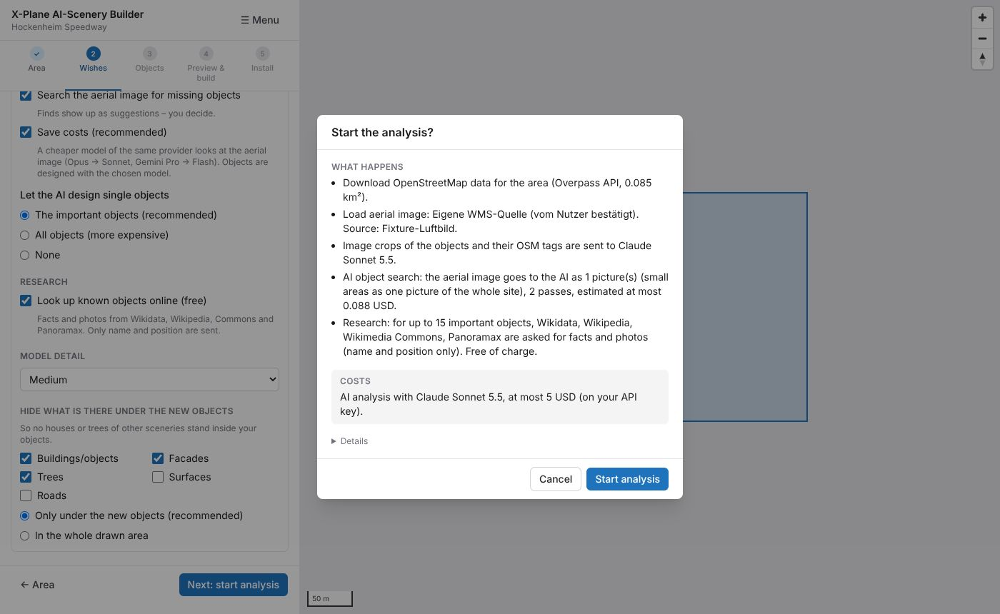

---

## 3. Step 1 – Area

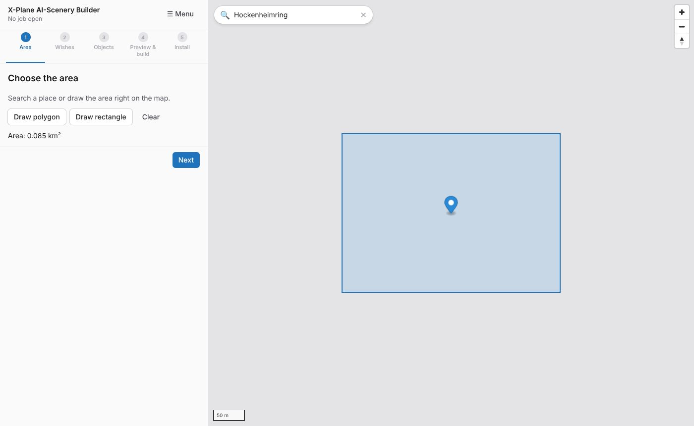

1. Type a place into the search field on the map (e.g. *Allianz Arena*, *Siklós castle*)
   and pick a suggestion – the map flies there. Or move and zoom the map yourself.
2. Click **Draw rectangle** (two opposite corners) or **Draw polygon** (click the corners,
   finish by clicking the first point again).
3. The area size is shown below. The maximum is **25 km²**.
4. Click **Next**.

**Tips**

- Draw the area a little larger than the object – the AI needs some surroundings, and
  the ground around the object belongs to the scenery.
- For a single landmark a few hundred metres are enough; for city mode up to a few km².
- Your recent jobs are listed under the drawing buttons; *All … jobs* opens the full list.

---

## 4. Step 2 – Wishes

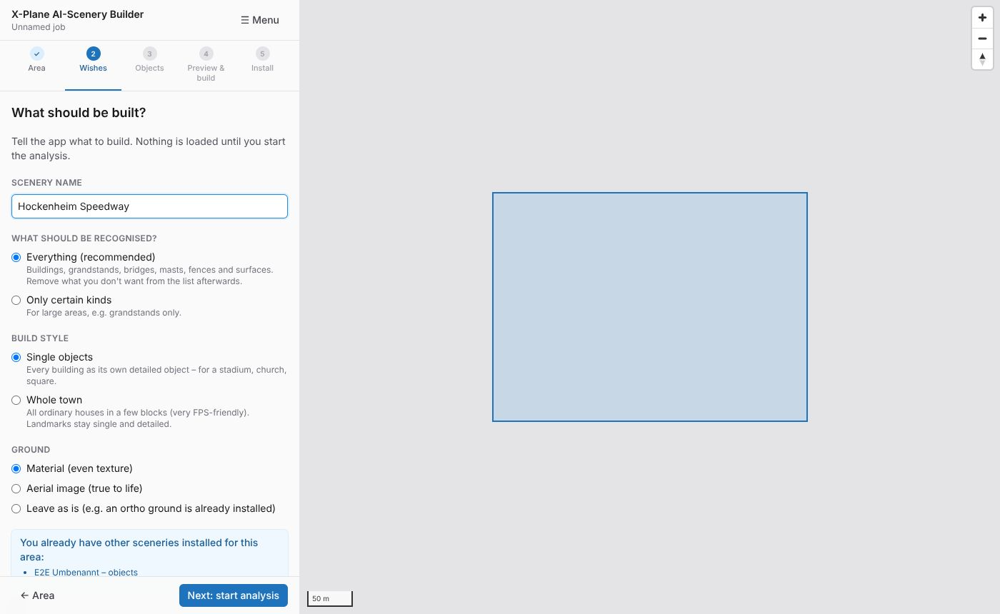

Nothing is downloaded yet in this step – you only describe what you want.

| Option | Meaning |
|---|---|
| **Scenery name** | The folder name in `Custom Scenery`. Letters without accents, digits, spaces, `-` and `_`. If you type accents, the app offers a fixed version. You can still rename the folder before installing. |
| **What should be recognised?** | *Everything* (recommended) – remove what you don't want later. *Only certain kinds* – for large areas, e.g. only grandstands. |
| **Build style** | *Single objects* – every building as its own detailed model (stadium, church, square). *Whole town* – all ordinary houses in a few blocks, landmarks stay detailed. See [City mode](#9-city-mode). |
| **Ground** | *Material* – an even texture (asphalt, grass, sand …). *Aerial image* – the real photo as ground texture (only with imagery that may be shared). *Leave as is* – if you already use an ortho scenery. |
| **AI** | Use AI or not, the **model**, and the cost limit for this job. Models whose key is missing are marked; the app points you to the settings. |
| **Notes for the AI** | Anything the AI should know: *"The main grandstand is roofed and has red seats."* |

If other sceneries for this area are already installed (e.g. an ortho or another
landmark pack), the app lists them here. With an ortho installed it suggests *Ground: leave
as is*, so your package does not cover it.

**More settings** (folded)

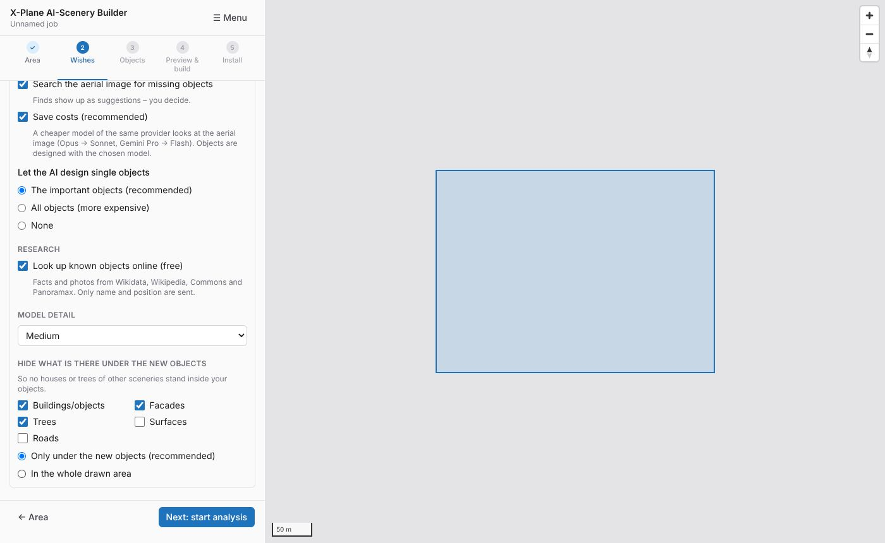

| Option | Meaning |
|---|---|
| Search the aerial image for missing objects | The AI looks for things the map does not know (e.g. stands, sheds). Finds appear as suggestions – you decide. |
| Save costs | A cheaper model of the same provider looks at the aerial image; only the design work uses your chosen model. Recommended. |
| Let the AI design single objects | *The important objects* (named, well-known, large – recommended), *All objects* (more expensive) or *None* (only the built-in build scripts). |
| Research | Looks up known objects on Wikidata, Wikipedia, Commons and Panoramax (free, only name and position are sent). |
| Model detail | Low / medium / high – more detail costs frame rate. |
| Hide what is there under the new objects | Removes houses, facades, trees, surfaces or roads of *other* sceneries where your objects stand, so nothing pokes through. *Only under the new objects* is usually right. |

Click **Next: start analysis**. The approval dialog shows the data sources, the AI model,
the maximum cost and the usual duration.

---

## 5. Step 3 – Objects

The app now loads the map data and the aerial image, asks the AI (if on) and researches
known objects. A progress list shows each stage with its time. Usually this takes a few
minutes.

**At the top** you see where the data came from (map, imagery, AI model, cost so far),
a switch for the aerial image on the map, and – if the AI was unsure – a few **questions**
with a suggested answer.

**The list** shows every object and surface. A click on an entry selects it on the map and
opens its details; a click on the map selects the entry in the list.

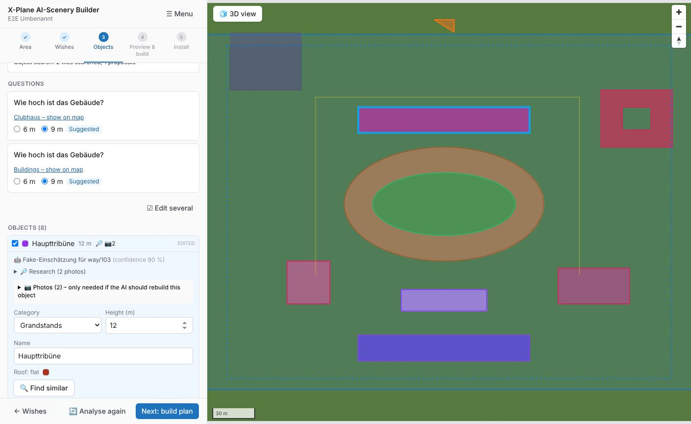

What you can do with an object:

- **Include / exclude** it (checkbox) – excluded objects are not built.
- Change the **category**, **height**, **levels**, **roof shape** and **colours**, **name**.
- **Find similar** – the AI searches the whole area for objects like this one (shows the
  maximum cost first).
- **Photos** – see the photos the research found, add your own (see
  [Photos and facades](#11-photos-and-facades)).
- **Split into single houses** – for a row of houses the app has joined (see below).
- **Delete** an object from the list (the map stays as it is; only your scenery leaves it out).
  Changed your mind? **Undo** in the note that appears, or `Ctrl+Z`.

**AI suggestions** (dashed on the map) are things the AI found in the aerial image but the
map does not know. Accept ✓ or discard ✗ each one, or **Accept all**.

**Something missing?** Under *Something missing? Draw it yourself* pick a kind and draw it
on the map.

**Edit several** lets you tick several entries and change their category at once.

**Rows of houses:** where the map splits a terrace into its single houses, the app joins
houses under one roof into one building (one long roof instead of a saw-tooth of small
gables). If that is wrong for a row, open it and click **Split into single houses**.

**The objects the AI architect will design** are listed in their own box – you can add
photos to them now.

**Analyse again** loads everything anew (e.g. after the map data was improved). Your
corrections stay remembered for this area.

When the list looks right: **Next: build plan**. The approval dialog shows how many objects
the AI architect will design and what it may cost at most.

---

## 6. Step 4 – Preview & build

While the build plan is made, the AI architect designs the important objects one after
another – the progress shows which one it is working on.

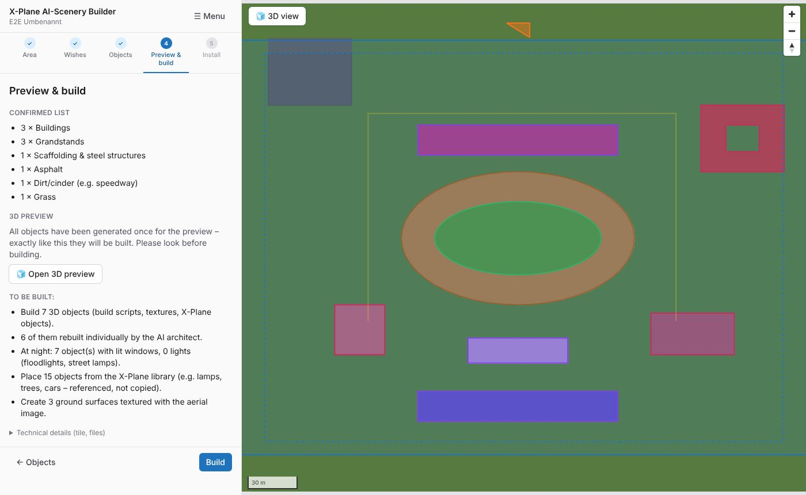

The plan lists what will be built (objects, lit windows, library objects, ground
surfaces). Technical details – the X-Plane tile and the file list – are folded.

**Open 3D preview** – please do this before building. Everything in it was really built:
what you see is what you get.

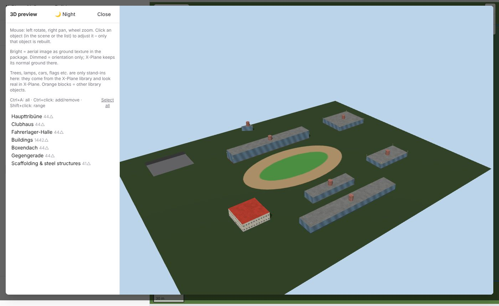

**Moving around:** left mouse button rotates, right button pans, the wheel zooms. Click an
object in the scene or the list to jump to it. **Night** switches to the night view
(lit windows, lamps, floodlights).

**Adjusting one object** – click it:

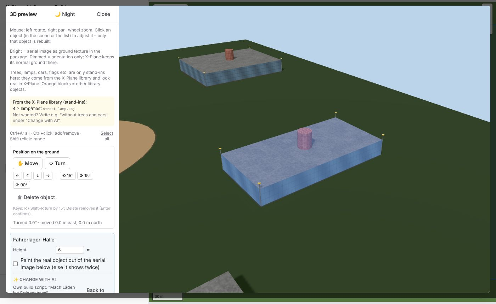

| Control | What it does |
|---|---|
| **Move** / **Turn** | Drag the object across the ground, or drag around it to turn it. Releasing saves. |
| ← ↑ ↓ → | Move by 1 m. |
| ⟲ 15° / ⟳ 15° / ⟳ 90° | Turn in steps. |
| **Delete object** | Removes it from the scenery (asks once). **Undo** (or `Ctrl+Z`) brings it back; all deleted objects stay listed under *Deleted objects* with **Restore** – also after the build. |
| Height, levels, roof, facade, colours | Changing a value rebuilds only this object, within seconds. |
| Turn ridge direction / Turn front around | Fix a roof ridge or a front that points the wrong way. |
| Paint the real object out of the aerial image below | Hides the real object in the ground photo, so it does not show twice. |
| **Change with AI** | Describe a change in your own words; the app shows the maximum cost before sending. *Back to default* undoes the AI design. **AI:** chooses the model for this one request – if a cheap model did not manage, the app offers to try a stronger one (the cost is shown again first). |

**Keyboard:** `R` / `Shift+R` turn by 15° · `Delete` removes the object (`Enter`
confirms, `Esc` cancels) · `Ctrl+Z` brings the last deleted object back · `Ctrl+A` selects all · `Ctrl+click` adds/removes from the
selection · `Shift+click` selects a range · `Esc` ends a multi-selection.

**Several objects** (Ctrl+click): change them together or ask the AI to change all of
them in one go.

**Single parts of an object** – a tower, the roof, a wing, the lamps: click **Edit parts**
in the *Parts* box, then click a part in the picture (it turns orange) or pick it from the
list. `Ctrl`/`Shift`+click adds more parts; **All alike** picks every part of the same kind
(e.g. all roofs).

| Control | What it does |
|---|---|
| ↑ ↓ ← → | Move north, south, west, east by the chosen step (0.2–5 m). |
| ⤒ ⤓ | Raise or lower. |
| ⟲ / ⟳ | Turn by 15° or 90° around the middle of the chosen parts. |
| Height / Width / Whole | Resize by −20 % … +25 %; height grows upwards from the part's base. |
| **Hide** | Leaves the part out of the scenery. |
| **Undo** / **Take all back** | The last change, or all changes to parts of this object. |

These changes are free and do not need the AI. With parts chosen, **Change with AI** works
on those parts only ("Only for: Tower") – e.g. *"make the spire twice as high and copper
green"*. The AI architect names the parts of its designs, so your part changes stay in
place when it changes something else.

**Build script by hand** – every object is built from a short script (Starlark, the same
sealed environment the AI architect writes in). Open the *Build script* box of the chosen
object to see it, change it, and click **Test**: a broken script shows the error with its
line; a working one shows triangles, time, parts and three views – the top view with a
grid in metres, so positions can be read off. **Use** puts it on the object (the object is
rebuilt), **Default script** goes back. Free, no AI involved. Pools, fountains and ponds
mapped inside a building's courtyards reach its script as `params["features"]` and are
built with water and a stone rim.

**Photo with Blender** – *Render photo with Blender* makes a photo-realistic picture
(Cycles: sunlight, sky light, cast shadows) of the whole scenery, or of the chosen object,
from the preview's current point of view. Takes a few minutes; click the picture to save it.

The preview also explains what is only a stand-in: trees, lamps, cars and flags come from
X-Plane's own library and look right in X-Plane, not in the preview.

When you are happy: **Build**. The build makes all textures, levels of detail and the
X-Plane files, and – if set up – lets Blender bake soft shading. **← Objects** goes back to
the list.

---

## 7. Step 5 – Install

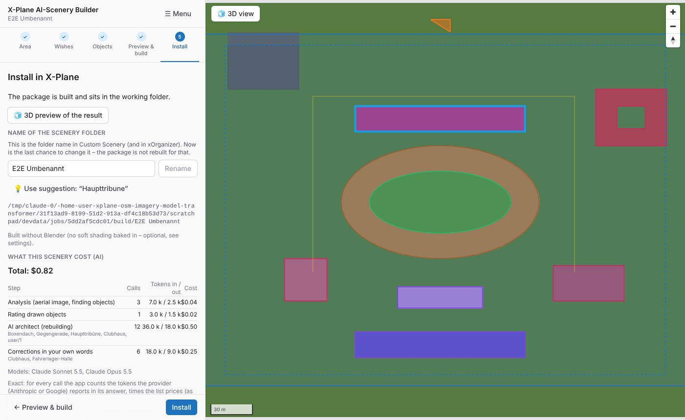

- **3D preview of the result** – the finished package, as it will be installed.
- **Scenery name** – last chance to rename the folder. The app suggests the name of the
  main landmark.
- The Blender line tells you whether the soft shading worked.
- **What this scenery cost (AI)** – every AI step with calls, tokens and cost.

Click **Install**. The approval dialog shows the target folder. If a folder of that name
already exists in `Custom Scenery`, it is **backed up** first (the path is shown afterwards).

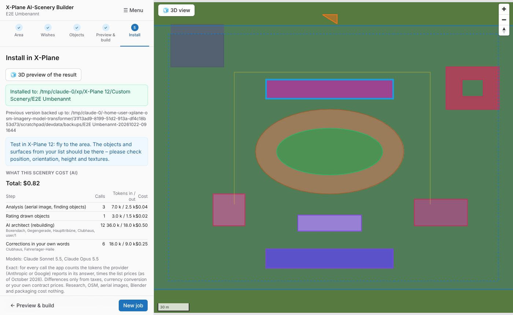

Start X-Plane (or reload the scenery) and fly to the area.

---

## 8. Changing things after the build

You do not have to start over for small changes:

- **Move, turn, delete or restore** objects in **3D preview of the result**. Only the placement file
  (DSF) is rewritten – in the package and, if installed, in X-Plane. Reload the scenery
  in X-Plane to see it.
- **← Preview & build** in step 5 goes back to the plan: preview, adjustments and AI
  designs stay, only the build is made again. Then build and install again.
- **← Objects** goes back to the list, e.g. to include more objects. The plan is made again.
- Every job stays in **☰ Menu → My jobs** – open it any time.

---

## 9. City mode

Choose **Build style → Whole town** in step 2.

- All ordinary buildings are built in **blocks** of about 250 × 250 m – a few large objects
  instead of thousands of small ones. X-Plane's frame rate stays high.
- **Landmarks** (named, well-known, large or designed by the AI) stay single, detailed
  objects.
- **In Bavaria** the app uses the official 3D buildings (LoD2) with their real roof shapes;
  elsewhere the map outlines with height and roof form.
- Houses wall to wall with the same height share one look and one roof colour; rows of
  houses get one long roof.
- **Standing in the ground, not on it:** a soft contact shadow around every house, a
  darker foot of the walls, and – with the aerial image as ground – the real roofs and
  yards around the houses painted over with darker soil at the walls.
- **Slopes:** with X-Plane's folder and DSFTool set up, every house stands on X-Plane's
  terrain height at its own place.
- The whole drawn area hides X-Plane's own autogen houses so nothing stands twice.
- **Style of the town:** *Central Europe (residential, suburbs)* or *Central Europe
  (historic city centre)*.

---

## 10. Bridges

Bridges are found on the map (and by the AI in the aerial image). The app builds beam,
arch, truss, suspension and cable-stayed bridges with piers and abutments, and joins them
to the roads with ramps.

- **Heights:** with X-Plane's folder and DSFTool set up, the deck meets X-Plane's own
  river banks, the piers reach the ground.
- **The real bridge in the aerial image** is painted out underneath, so you don't see two
  bridges. You can switch this per object.
- In the preview you can change the structure, height and width of a bridge.

---

## 11. Photos and facades

Photos help the AI architect get shape, material and details right.

- **Where they come from:** Wikimedia Commons, Panoramax, Mapillary (with token) and your
  own uploads. Thumbnails show source and licence.
- **Your own photos:** *Add own photos* – tick that you may use them.
- **Facade from photo:** open a photo, drag the four blue dots onto the corners of the
  facade, enter its real width and height, and apply. The app straightens the photo and
  puts it on the model as a texture. For repeating facades (stadiums, offices) mark a clean
  piece and tick *Pattern*.
- **Facades from street photos (automatic):** street-level photos from Panoramax or
  Mapillary know where the camera stood and where it looked. For ordinary buildings
  (default script) the app paints every wall such a photo shows straight from the photo,
  seen from the right angle, as in a game. Walls nobody photographed keep their drawn
  windows. Used when the photos show at least about one side of the building; parked cars or
  trees in the photo end up on the wall too. Hand-designed landmarks keep their modelled
  facades.
- **Licences:** a photo only goes **into your package** if its licence allows sharing
  (own photos, CC0, public domain, CC BY, CC BY-SA). Photographers and licences are listed
  in the package's `README.txt`. Other photos are only shown to the AI as a reference.

---

## 12. Working with the AI

**Providers and keys.** Claude (Anthropic) and Gemini (Google) are supported. Put one key
or both into **Settings → AI**. In step 2 you pick the model per job; models without a key
are marked.

**Which model?**

| | Claude | Gemini |
|---|---|---|
| Best quality | Opus 5.5 | 3.1 Pro (preview) |
| Balanced | Sonnet 5.5 | 3.8 Flash, 3.6 Flash |
| Cheapest | Haiku 5.5 | 3.5 Flash-Lite, 3.1 Flash-Lite |

For landmarks the best model of a provider gives the best designs. With *Save costs* on,
the aerial image is looked at by the cheaper model anyway.

Google renames and retires Gemini models often. **Settings → AI → Load available Gemini
models** asks Google which models your key can use right now and adds them to the list.
The 2.5 models are only served to accounts that used them before.

**What the AI gets:** crops of the aerial image, the map tags of the objects, the research
facts and photos, and your notes. It never gets your keys, files or anything else from your
computer.

**What the AI produces:** answers to questions, suggestions, and build scripts. Build
scripts run in a sandbox (Starlark) that can only describe geometry – no files, no network,
limited time and triangles. Blender only ever runs the fixed script shipped with the app.

**Costs and limits**

- **Cost limit per job** (default 5 USD): the most a single job may spend – analysis,
  designs and corrections together. Set the default in **Settings → AI**, change it per job
  in step 2.
- **Monthly limit, all jobs together** (default 20 USD): a brake for the whole calendar
  month. Once it is reached no AI step starts, however much a job could still spend.
  The settings show what was spent this month.
- Whichever limit is reached first applies. If the monthly limit is lower than the job limit,
  the settings warn you.
- Every AI step shows its **maximum** cost before it starts. The app stops when a limit is
  reached and keeps what was done.
- After the build, step 5 lists every call with exact tokens and cost, counted from what
  the provider reports, times the list prices.
- Prices are per million tokens; the model list in the settings shows them.

---

## 13. Settings

**☰ Menu → Settings.** Click **Save** at the bottom after changes.

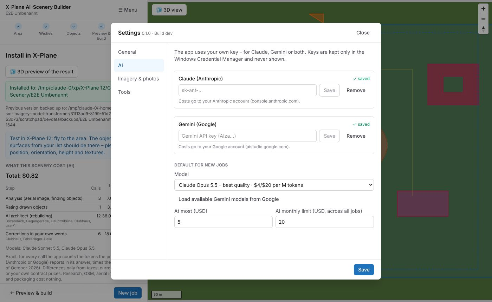

**General**

- **X-Plane 12 folder** – type it or *Detect automatically*.
- **Language** – English or German.

**AI**

- **Claude (Anthropic)** and **Gemini (Google)** keys – *Save*, *Remove*. The status shows
  ✓ *saved* or *no key*. Keys are stored only in the Windows Credential Manager and never
  shown again.
- **Default for new jobs** – model (with prices), job limit, monthly limit.
- **Load available Gemini models** – see [Working with the AI](#12-working-with-the-ai).

**Imagery & photos**

- **Aerial imagery source:** *Automatic* picks the best open source for the area (state
  orthophotos in Germany, swisstopo, basemap.at, PDOK, IGN France and Spain, USGS NAIP,
  GSI Japan). Or choose one, **Esri** (your own key, recognition only), **Custom** (your own
  WMS or XYZ source – you must confirm you are allowed to use it) or **None**.
- **Mapillary token** for more street-level photos.

**Tools**

- **DSFTool** – comes with the app; a custom path is optional. Needed to build packages and
  for terrain heights.
- **Blender** – use it or not, custom path, *Automatic* (graphics card if found) or *CPU only*, and **Test Blender**:
  bakes a test building and shows how long each part takes. **Quality**: *Standard* or
  *Fine* (four times the samples, finer shading and relief – about ten times longer; the
  estimate before the build says how long).
- **OpenStreetMap data** – an own Overpass server (optional, asked first). Without it the
  app uses four public servers; if they are busy it asks the next one after 25 s, then uses
  older data from its cache or OpenStreetMap's own API.

---

## 14. Your scenery in X-Plane

- The package is a normal overlay scenery in `Custom Scenery\<your name>` with a
  `README.txt` (sources, licences, photographers).
- **Order in `scenery_packs.ini`:** your package must be **above** other packs of the same
  area (autogen packs like OSM-based ones, other landmark packs), otherwise their objects
  can show through. New packages are added at the top by X-Plane. Your package can hide
  objects of packs *below* it – that is what *Hide what is there under the new objects*
  does.
- An ortho scenery for the area stays visible if you chose *Ground: leave as is*.
- After moving or deleting objects in the app, reload the scenery in X-Plane (or restart).

---

## 15. Troubleshooting and FAQ

**The analysis hangs at "OSM data".**
The public OpenStreetMap servers are sometimes overloaded. The progress shows which server
is asked; after at most about 2½ minutes the app falls back to older data or OSM's own API.
If it happens often, enter another Overpass server in *Settings → Tools*.

**A landmark is missing from the list (e.g. a castle).**
Check on [openstreetmap.org](https://www.openstreetmap.org) (right click → *Query
features*) how it is mapped. If it is only an area without a building, turn on *Search the
aerial image for missing objects* or draw it yourself in step 3.

**"No key for Claude/Gemini".**
Add the key in *Settings → AI*, or choose a model of the provider you have a key for.

**"This model is not (or no longer) available for your key."**
Google has retired or restricted the model. Click *Load available Gemini models* and choose
another one.

**The cost limit was reached.**
What was done is kept. Raise the job or monthly limit in *Settings → AI* (or the job limit
in step 2) and continue.

**Houses float or sink on a slope (city mode).**
Set the X-Plane folder (and keep DSFTool), then **Analyse again** – the terrain heights are
read during the analysis.

**Objects of another scenery stand inside mine.**
Make sure your package is above that pack in `scenery_packs.ini` and that *Hide what is
there under the new objects* is on.

**I see the real building twice (in the photo on the ground and as a model).**
Use the ground *Aerial image* only where it fits, or tick *Paint the real object out of the
aerial image below* for that object in the preview.

**Building the preview or the package takes long.**
The objects are built on all processor cores at once (one core stays free for the app), so
a faster CPU with more cores helps most. The 3D view itself runs on the graphics card; if
the preview warns that it runs *without a graphics card*, update the graphics driver and do
not start the app over remote desktop.

**Research found no facts or photos.**
If the note says *no source was reachable*, the computer could not reach Wikidata,
Wikipedia or Commons (offline, a firewall or a blocked service) – it is not that nothing
exists. Check the connection and analyse again.

**Blender does nothing / is slow.**
*Settings → Tools → Test Blender* shows what takes the time. *CPU only* skips the graphics
card search; the log path is shown for reports.

**Where are my files?**
Jobs, caches and backups live in `%APPDATA%\XPlaneAISceneryBuilder`. The finished package is
in `Custom Scenery`.

**Does the app change anything else in my X-Plane folder?**
No. It only writes your package folder into `Custom Scenery` (after the install approval)
and backs up a folder of the same name first.

---

## 16. Glossary

| Term | Meaning |
|---|---|
| **Overlay scenery** | A scenery package that adds objects on top of X-Plane's ground. |
| **Ortho / orthophoto** | An aerial photo used as ground texture. |
| **OSM / Overpass** | OpenStreetMap, the free world map; Overpass is the service the app asks for the map data. |
| **DSF / DSFTool** | X-Plane's scenery file format and Laminar's tool to write it. |
| **OBJ8** | X-Plane's 3D object format. |
| **LoD2** | Official 3D buildings with real roof shapes (here: Bavaria). |
| **AI architect** | The AI that designs single objects as build scripts. |
| **Build script** | A small program (Starlark) that describes an object's geometry; runs in a sandbox. |
| **Levels of detail (LOD)** | Simpler versions of an object for larger distances. |
| **Library object** | An object from X-Plane's own library (lamps, trees, cars), placed but not copied. |
| **Exclusion** | A zone in which objects of other sceneries are hidden. |
